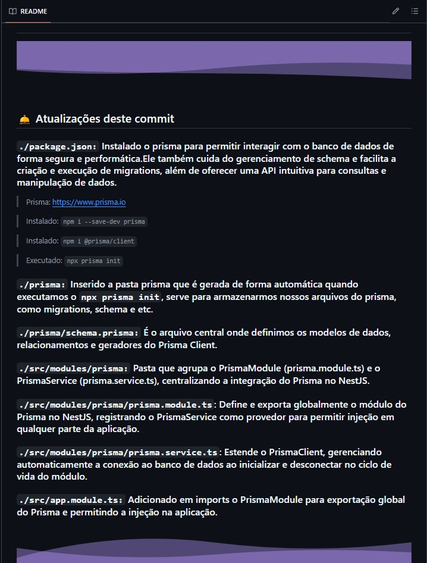
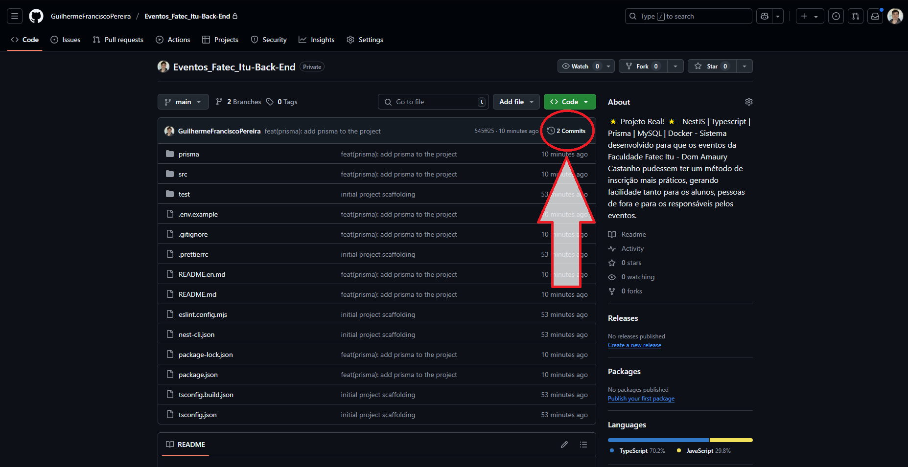
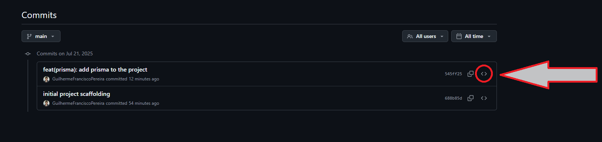
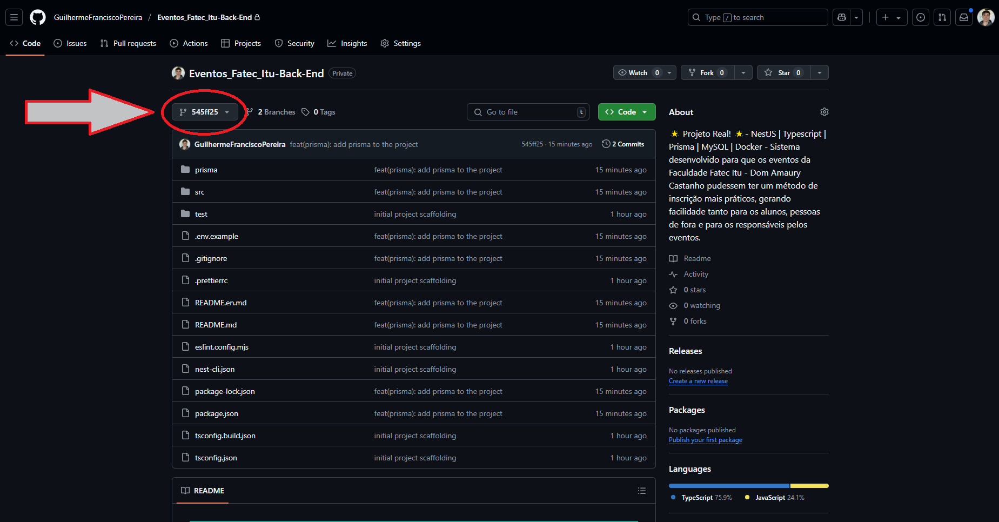
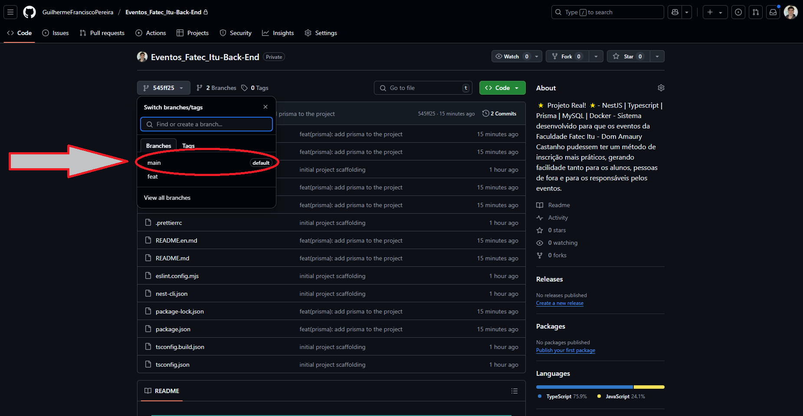

# 📅 System - Fatec Itu 📅

<p align="left">
<a href="./README.md">

</a>
</p>

## ⭐ Back-End Repository

## 📌 About the project

### This system was developed to make registration for events at Faculdade Fatec Itu - Dom Amaury Castanho more practical, streamlining the process for both students and external participants. It is also used by coordinators and organizers for event management, enabling participant tracking, automated issuance of valid certificates, and other features that streamline administration.

### 👥 The system is being developed by Guilherme Francisco Pereira as part of his Final Project (TCC), with real-world application and practical use.

### ✨ Interesting fact: this is one of the systems developed exclusively by students that is already implemented and used by the college, benefiting students, professors, coordinators, and others involved!


##


## 🛎️ Updates to this commit

### `Safer and lighter image uploads (events, carousel and profile photo):` Files were kept whole in the API memory and their type was not checked, so a large upload could take the API down. Now the file goes to the server temp folder (it is never held whole in memory), only JPG, PNG, WEBP, GIF or AVIF images are accepted (checked by the first bytes of the file, so a PDF renamed to .jpg is refused) and the temp file is deleted at the end of every request. There is no size limit: images above 5 MB are optimized automatically with `sharp` (resized to at most 2560 px on the longest side and converted to WebP), and smaller ones are kept as sent. In a test, a 24.4 MB image went down to 1.1 MB.

### `Registrations by e-mail protected:` The public route `GET /events/public/by-participant-email` showed which events any e-mail was registered in. It was removed and the lookup moved to `GET /events/manage/by-participant-email`, which requires an ADMIN, COORDENADOR or AUXILIAR login and is recorded in the audit trail. The front-end did not use this route.

### `Password reset no longer reveals registered e-mails:` The answer was "E-mail não cadastrado" (e-mail not registered), which let anyone find out which e-mails exist. Now the API always answers "Se o e-mail informado estiver cadastrado, você receberá um código para redefinir a senha em instantes." (if the e-mail is registered, you will receive a code), sets the same cookie and creates the same code record in both cases, and sends the e-mail in the background so the response time does not give the account away either. On login, an unknown e-mail now takes as long as a wrong password.

### `Sessions ended when the password or role changes:` Changing a user's password (by the admin or through the reset) or role did not end the open sessions, and the refresh copied the old role from the token, so a demoted user kept the access. Now each user has a `sessionVersion` that goes inside the tokens: a change raises this number and revokes the refresh tokens, the `JwtStrategy` checks the user in the database on every request (the role always comes from the database) and the refresh builds the new session from the current database data. When the renewal fails, the session cookies are deleted too.

### `Single-use codes and cookies that are really deleted:` The 2FA and reset codes were tracked only in the API memory. Now they live in the new `AuthCode` table (only the code hash): each code works only once even if the API restarts, asking for a new code cancels the previous one and after 5 wrong attempts the code is blocked. `clearCookie` used `path: '/auth'`, but the cookies are created with `path: '/'`, so they were never deleted; now creating and clearing use the same options.

### `Audit trail:` New `./src/modules/audit` module that records everything that changes data (creations, edits, removals, registrations and attendance), plus login, logout, refused attempts, password reset requests and changes, access denied for lack of permission and two views with personal data (the participants list of an event and the registrations lookup by e-mail). Each record keeps who did it (name, e-mail, role and id at the time), when, the result (success, error or refused, with the HTTP code), IP, browser, all the data before and after, what changed field by field, the data sent and the response. Passwords, codes, tokens and the attendance secret word are never stored (they show as `[PROTEGIDO]`). The `GET /audit` (paginated, with search and filters) and `GET /audit/:id` routes are ADMIN only. Records are kept for 365 days (configurable with `AUDIT_RETENTION_DAYS`) and then removed by a daily job.

### `Dependencies:` The discontinued `csurf` was replaced by `csrf-csrf` without changing how the front-end uses it (same `/csrf-token` route and same `X-CSRF-Token` header). Updated `@nestjs/core`, `@nestjs/common` and `@nestjs/platform-express` (11.2.7), `multer` (2.4.0), `path-to-regexp` (8.4.2), `proxy-addr` (2.0.8), `nodemailer` (7 to 10.1.1), `@nestjs/swagger` (11.4.7, with its internal `js-yaml` forced to 5.4.3), `jest` (30), `ts-jest`, `@types/jest` and `@swc/cli` (0.8.1), and added `sharp`. `npm audit` went from 84 alerts (4 critical) to 23, none critical: the remaining ones are in development-only tools (Jest and the Prisma CLI) and would only be fixed by a major version change.

### `Database:` New migration `20261015120000_add_session_version_auth_codes_and_audit_log`, which creates the `sessionVersion` column in `User` and the `AuthCode` and `AuditLog` tables. It is applied by the `npx prisma migrate deploy` that already runs on deploy.

### `Tests:` The suite went from 7 failing tests (empty test files, an outdated carousel test and cookie names in the auth controller test) to 225 passing tests in 24 files. New tests cover the audit trail, `RolesGuard`, image validation and optimization, the events controller and the courses and locations modules, and the auth and users tests now cover single-use codes, the neutral answer and the end of sessions.

### `.env.example and Swagger:` `.env.example` now lists the security variables the code already required (`JWT_PRIVATE_KEY`, `JWT_PUBLIC_KEY`, `JWT_REFRESH_SECRET`, `PASSWORD_PEPPER` and `TOKEN_HASH_SECRET`) and the new optional `CSRF_SECRET` and `AUDIT_RETENTION_DAYS`. Swagger got the `Audit` tag.


##

## 🖥 Technologies Used
<div align='center'>


</div>

## Versions used: 
    - Nest: 11.2.7
    - Typescript: 5.9.3
    - Prisma: 6.19.2
    - MySQL: 8.0.42
    - Docker: 28.3.2
    - Swagger/OpenAPI: @nestjs/swagger 11.4.7

## 🙋🏻‍♂ How can I locate myself in the project?

### All project source code files are in: `./src` and E2E tests are in: `./test`

## 🛈 How the project is structured

- `./prisma:` Prisma allows you to interact with the database securely and efficiently. It also handles schema management and facilitates the creation and execution of migrations, in addition to offering an intuitive API for queries and data manipulation.
    - `schema.prisma:` This is the central file where we define the Prisma Client's data models, relationships, and generators. It includes the user `sessionVersion` and the `AuthCode` (single-use 2FA and reset codes) and `AuditLog` (audit trail) tables.
    - `migrations:` Versioned history of the database changes, applied on deploy with `npx prisma migrate deploy`.

- `./.github/workflows/deploy.yml:` GitHub Actions workflow responsible for backend CI/CD. Upon receiving a `git push` on the `main` branch, it builds the Docker image, publishes it to the GitHub Container Registry, and automatically updates the backend container on the VPS.

`./Dockerfile:` File responsible for defining the backend containerization process. It uses Node.js 22 Bookworm Slim and multi-stage build to install dependencies with `npm ci`, generate the Prisma Client with `npx prisma generate`, compile the NestJS application with `npm run build`, and run the API in production mode on port `4000`.

- `./dockerignore:` Defines which files and directories should be ignored during the Docker image build.

- `./test/` Directory dedicated to end-to-end (e2e) tests:
    - `app.e2e-spec.ts`: Our e2e tests to validate endpoints and main API flows ensure that scenarios work as expected, testing success flows and error flows, such as validation, authorization, etc. It uses the same CSRF protection as the application (`createCsrfProtection`).
    - `jest.e2e-json`: Jest configuration file for running e2e tests (defining recognized file extensions, starting point for test searches, transforms, etc.)

- `./src/app.module.ts`: Root module that declares/imports the application's other modules, controllers, and providers.
- `./src/main.ts`: Application entry point, where Nest is initialized and configured (Helmet, CORS, cookies, CSRF protection with `csrf-csrf`, global validation and Swagger).
- `./src/swagger.ts`: Central Swagger/OpenAPI documentation configuration, including title, description, version, servers, cookie authentication, CSRF, tags, and UI route at `/apiEvents/docs`.

- `./src/assets:` directory to organize additional static resources.
    - `readme:` Folder that will store our photos for use in the documentation ( README )

- `./src/decorators:` Folder for custom decorators.
    - `audit.decorator.ts:` Defines the `@Audit` decorator, which describes how a route shows up in the audit trail (action, area, summary and where the affected record comes from), and `@SkipAudit`, for automatic calls that are not an act of the user, such as the session renewal.
    - `public.decorator.ts:` Defines a decorator to allow public routes to unauthenticated users.
    - `roles.decorator.ts:` Defines a decorator to indicate which user profiles are allowed to access each endpoint.

- `./src/guards:` Folder for authentication and authorization guards.
    - `jwt-auth.guard.ts:` Ensures that only requests authenticated with a valid JWT token are accepted and populates user data in the request.
    - `roles.guard.ts:` Controls access based on the user profile, allowing unrestricted endpoints and blocking them when the profile does not match the permitted ones. Every denied access is recorded in the audit trail.
    - `roles.guard.spec.ts:` Guard tests: allowed role, refused role recorded in the audit trail and request without user.

- `./src/modules:` The modules folder contains all the application modules, each in its own directory to keep logic, controllers, and providers well-organized and decoupled, all then imported by the root module (AppModule).
    - `audit:` Audit trail module: records who did what, when and with which result, without storing passwords, codes or tokens.
        - `dto:` Data Transfer Objects for the listing (filters and pagination) and for the summary and detailed responses.
        - `audit.context.ts:` Request context (AsyncLocalStorage) that lets services report the actor, the affected record and extra details, as in the login or in the optimization of an image.
        - `audit.controller.ts:` Exposes `GET /audit` (paginated, newest first, with search and filters by result, area, action and period in Brasília time) and `GET /audit/:id` (all details), both ADMIN only.
        - `audit.interceptor.ts:` Global interceptor that records every change made through the API and the routes marked with `@Audit`: it reads the record before and after, calculates what changed and stores the result, also when the operation fails or is refused.
        - `audit.interceptor.spec.ts:` Interceptor tests: edit with before/after, creation, refused login, business rule error, data reported by services, password as a protected change, list view and routes with `@SkipAudit`.
        - `audit.module.ts:` Global module that registers AuditService, AuditController and the interceptor.
        - `audit-sanitizer.ts:` Functions that mask passwords, codes, tokens, hashes and secrets, limit the size of what is stored and calculate the field-by-field difference.
        - `audit-sanitizer.spec.ts:` Tests for the masking, the size limit and the calculation of what changed.
        - `audit.service.ts:` Writes the records (a failure to write never undoes the user's operation), builds the snapshot of each affected record with the names of its relations, lists and details the records and deletes the ones older than the retention period.
        - `audit.service.spec.ts:` Tests for writing without credentials, record snapshots, pagination with filters and retention.
        - `audit.utils.ts:` Shared functions: actor from the session, area from the controller, result from the HTTP code and request origin.

    - `auth:` Module dedicated to the entire user authentication and authorization flow.
        - `dto:` Folder containing Data Transfer Objects that define the input and output format of authentication requests. In short, it's our "Typing."
        - `auth.controller.ts:` Exposes the endpoints for me, refresh, logout, request-login, login, request-reset-password, and reset-password, manages the access, refresh, 2FA and reset cookies (created and cleared with the same options, so they are really removed), and provides a dedicated route to renew the session without depending on the front-end initial load. The reset request always gives the same answer whether the e-mail exists or not, and an ended session also has its cookies cleared.
        - `auth.controller.spec.ts:` Covers controller integration tests, validating scenarios for valid token, expired token, refresh renewal, ended session with cleared cookies, missing refresh token, logout, login with 2FA, neutral reset answer, and password reset.
        - `auth.service.ts:` Encapsulates all authentication business logic—user verification, password hashing, access token generation and verification, refresh token rotation (always with the current role from the database and the `sessionVersion`), single-use 2FA and reset codes stored in the `AuthCode` table, the same answer for existing and unknown e-mails, ending the sessions on a password change, sending e-mails in the background, and clearing expired tokens and codes.
        - `auth.service.spec.ts:` Tests the authentication service flows, ensuring correct behavior in cases of invalid credentials, token generation, single-use codes (also after an API restart), blocking after 5 attempts, neutral reset answer, ending the sessions, role taken from the database on refresh, revocation, and renewal of refresh tokens.
        - `auth.module.ts:` Configures the authentication module, imports PrismaModule, ConfigModule, JwtModule with RSA keys loaded from environment variables, and registers AuthService, JwtStrategy, and EmailService
        - `jwt.strategy.ts:` Extracts the JWT from the access cookie, validates its signature and expiration using the public key, checks in the database that the user exists and that the token's `sessionVersion` is still the current one, and provides user data (ID, name, email and role from the database) to the guards

    - `carousel:` Package dedicated to the complete management of image collections displayed in a carousel in the system, encompassing all CRUD operations and photo presentation.
        - `dto:` Directory containing the Data Transfer Objects (CreateCarouselDto, UpdateCarouselDto, and CarouselResponseDto) responsible for defining the format of the input and output data in carousel requests.
        - `carousel.controller.ts:` Defines the REST endpoints for listing (GET /carousel), creating (POST /carousel/post), updating (PATCH /carousel/patch/:id), updating only the isActive field (PATCH patch/toggle/:id), and removing (DELETE /carousel/delete/:id) image items in the carousel. - `carousel.controller.spec.ts:` Controller integration tests, ensuring that each route correctly forwards calls to the CarouselService and returns the expected HTTP codes.
        - `carousel.service.ts:` Implements the carousel's business logic — interacts with PrismaClient to retrieve, insert, modify, and delete records in the Carousel table, and integrates with the Cloudinary module to save and delete images in the Cloudinary.
        - `carousel.service.spec.ts:` Unit test suite for the service, using an in-memory table, covering success and failure scenarios for each method exposed by CarouselService, including the order reorganization and the image replacement.
        - `carousel.module.ts:` Carousel module configuration file, importing PrismaModule and CloudinaryModule, registering CarouselService and CarouselController in the NestJS context. The image upload is handled by `ImageUploadInterceptor`.

    - `categories:` Package dedicated to complete category management, encompassing all CRUD operations.
        - `dto:` Directory containing the Data Transfer Objects (CreateCategoryDto, UpdateCategoryDto, and CategoryResponseDto) responsible for modeling the input and output data in category requests.
        - `categories.controller.ts:` Defines the REST endpoints for listing (GET /categories), creating (POST /categories), updating (PATCH /categories/:id), and deleting (DELETE /categories/:id) categories.
        - `categories.controller.spec.ts:` Controller integration tests, ensuring that each route correctly forwards calls to the CategoriesService and returns the expected HTTP codes. - `categories.service.ts:` Implements the business logic of categories — interacts with PrismaClient to search for, insert, modify, and delete records in the Category table.
        - `categories.service.spec.ts:` Unit test suite for the service, covering success and failure scenarios for each method exposed by CategoriesService.
        - `categories.module.ts:` Assembly file for the categories module, importing PrismaModule and registering CategoriesService and CategoriesController in the NestJS context.
    
    - `certificates:` Module responsible for storing and exporting the logic for sending certificates to students who attended the event.
        - `certificates.module.ts:` Imports ScheduleModule.forRoot() and PrismaModule and exports the service for use elsewhere in the code.
        - `certificates.controller.ts`: Provides the route for validating whether the certificate is real or not and whether it belongs to the person.
        - `certificates.service.ts:` All the logic for sending certificates to students who attended the previous day's events.
    
    - `cloudinary:` Exports the option to insert or remove photos from Cloudinary (free service for saving images, I recommend: https://cloudinary.com)
        - `cloudinary.module.ts:` Imports our provider and service and exports the service for use elsewhere in the code
        - `cloudinary.provider.ts:` Configures the connection to Cloudinary
        - `cloudinary.service.ts:` Exports the functions for uploading and deleting a photo. Sends the file from disk (or memory) to Cloudinary after the optimizer and answers with a friendly message when Cloudinary refuses the upload.
        - `image-optimizer.ts:` Optimizes only images above 5 MB: resizes them to at most 2560 px on the longest side and converts them to WebP with `sharp`. If the result is not smaller or the image cannot be processed, the original is sent.
        - `image-optimizer.spec.ts:` Optimizer tests: light image kept, heavy image reduced and converted with the temp file deleted, and invalid file sent as it is.

    - `common:` We concentrate functionality shared by multiple modules; this is where components that don't belong to a specific domain are stored.
        - `csrf.controller.ts:` Exposes an endpoint to obtain the user's CSRF token, ensuring that each call actually comes from the legitimate application and not a malicious website, thus preventing CSRF.
        - `csrf.ts:` Creates the CSRF protection with `csrf-csrf` (replacement for the discontinued `csurf`), keeping the same contract with the front-end: `GET /csrf-token` returns the token and every change sends the `X-CSRF-Token` header.
        - `event-clock.ts:` Converts the current moment to the Itu time in the same format the event times are stored in, so comparisons with "now" (public events, available dates, registrations and certificates) do not depend on the server time zone.
        - `image-upload.interceptor.ts:` Interceptor used in the image uploads (events, carousel and profile photo): writes the file to the temp folder instead of memory, accepts only JPG, PNG, WEBP, GIF or AVIF by checking the first bytes of the file and deletes the temp file at the end of the request. It does not limit the size.
        - `image-upload.interceptor.spec.ts:` Tests for recognizing images by their first bytes and refusing files that are not images.

    - `events:` Package dedicated to complete event management, encompassing CRUD operations, image upload, date and time availability checks, and attendance validation via secret word.
        - `dto:` Directory containing the Data Transfer Objects (CreateEventDto, UpdateEventDto, ValidatePresenceDto, and EventResponseDto) responsible for defining the format of input and output data in event requests.
        - `events.controller.ts:` Defines the REST endpoints for listing (GET /events), public search by ID (GET /events/:id, without participants or the secret word), full search by ID for editing (GET /events/manage/:id), lookup of the registrations of a participant by e-mail (GET /events/manage/by-participant-email, only for ADMIN, COORDENADOR and AUXILIAR and recorded in the audit trail), creating (POST /events/create), partial updating (PATCH /events/patch/:id), deleting (DELETE /events/delete/:id), confirming attendance by secret word and registration e-mail (PATCH /events/:eventId/participants/:participantId/presence, limited to 10 attempts per minute), date availability (GET /events/availability/dates) and time availability (GET /events/availability/times). All protected by JwtAuthGuard and RolesGuard, with @Roles decorator for ADMIN and COORDINATOR profiles, `ImageUploadInterceptor` for image upload and appropriate HTTP codes (201 for creation, 200 for deletion), only public routes do not need to be authenticated, such as the public listing of events and attendance confirmation.
        - `events.service.ts:` Implements all the business logic for events — interacts with PrismaClient for CRUD operations, validates time conflicts to avoid overlap, uses CloudinaryService for uploading and deleting images, dynamically calculates available date and time slots according to the location and date provided, makes sure public routes return only the public event data, and validates the secret word and the registration e-mail to mark the participant as present.
        - `events.service.spec.ts:` Unit test suite for EventsService, covering creation scenarios without a file, detecting schedule overlaps, successful creation with image upload, updating with and without a new file (including deletion and upload to Cloudinary), calculating availability for times and dates for different locations, deleting an event with image deletion, and handling ConflictException and NotFoundException exceptions.
        - `events.controller.spec.ts:` Controller tests: e-mail lookup requiring login and role, audit record, absence of the old public route and forwarding of the attendance check.
        - `events.module.ts:` Events module configuration file, importing PrismaModule and CloudinaryModule, and registering EventsService and EventsController in the NestJS context.

    - `locations:` Package dedicated to the complete management of locations, encompassing all CRUD operations and serving as a relational base for event registration.
        - `dto:` Directory containing the Data Transfer Objects (`CreateLocationDto`, `UpdateLocationDto`, `LocationResponseDto`, and `LocationPublicResponseDto`) responsible for modeling the input and output data in location requests.
        - `locations.controller.ts:` Defines the REST endpoints for administrative listing (GET /locations), public listing (GET /locations/publicAllLocations), creation (POST /locations/create), update (PATCH /locations/patch/:id), and removal (DELETE /locations/delete/:id) of locations registered in the system.
        - `locations.service.ts:` Implements the business logic for locations — interacts with PrismaClient to search, insert, modify, and delete records in the `Location` table, including existence validations, duplicate name conflicts, and protection against event-bound location deletion.
        - `locations.controller.spec.ts:` Controller tests: public listing open, operations forwarded to the service and audit record.
        - `locations.service.spec.ts:` Service tests: duplicate names, missing location and blocking the removal of locations linked to events.
        - `locations.module.ts:` Configuration file for the locations module, importing PrismaModule and registering LocationsService and LocationsController in the NestJS context.
    
    - `participants:` Module dedicated to the complete flow of participant registration and attendance control in events
        - `dto:` Contains the Data Transfer Objects (CreateParticipantDto, UpdateParticipantDto, and ParticipantResponseDto) that define the form of input and output data in participant operations
        - `participants.controller.ts:` Exposes the registration (POST /participants/create) and attendance update (PATCH /participants/patch/:id) endpoints, applies JwtAuthGuard and RolesGuard for ADMIN, COORDINATOR, and AUXILIARY, and marks the creation route as public
        - `participants.controller.spec.ts:` Integration test suite that validates public registration, access attempts without authentication, and authorized attendance updates
        - `participants.service.ts:` Encapsulates all registration and attendance business logic, including checking for duplicate email and RA per event, validation institutional domain, incrementing the participant counter, persisting registration, and sending confirmation emails
        - `participants.service.spec.ts:` Unit tests the service, covering email/RA conflict scenarios, participant creation, updating attendance, and sending confirmation emails
        - `participants.module.ts:` Configures the participants module by importing PrismaModule, declaring ParticipantsService and EmailService as providers, and registering ParticipantsController as the controller

    - `prisma:` Bundles the PrismaModule (prisma.module.ts) and PrismaService (prisma.service.ts), centralizing Prisma integration in NestJS.
        - `prisma.module.ts`: Defines and globally exports the Prisma module in NestJS, registering the PrismaService as a provider to allow injection into any part of the application.
        - `prisma.service.ts`: Extends PrismaClient, automatically managing the database connection during initialization and disconnection during the module lifecycle.
    - `users:` Module responsible for all user CRUD operations.
        - `dto:` Folder with Data Transfer Objects that define the input and output format of user requests. In short, it's our "Typing".
        - `users.controller.ts`: Exposes the get, post, patch, and delete endpoints for the user CRUD.
        - `users.controller.spec.ts`: Controller integration tests, ensuring that each route correctly invokes the UsersService.
        - `users.service.ts`: Business logic for the users module, handling requests that arrive on the controller routes, searching for all users, registering, updating, and deleting them. When a user's password or role changes, it raises the `sessionVersion` and revokes the refresh tokens, ending all their open sessions at once.
        - `users.service.spec.ts`: Unit tests for the UsersService, covering success and error scenarios for each method. - `users.module.ts:` Configures the UsersModule, importing PrismaModule and ConfigModule, and registering UsersService and UsersController.
        - `./src/services:` Brings together injectable classes that encapsulate business logic, utilities, and external integrations.
          
- `./src/services`: Brings together injectable classes that encapsulate business logic, utilities, and external integrations.
    - `email.service.ts:` We have the configurations for sending emails and the send method that we will actually use to send emails.

## ❔ How do I run the project on my machine?

- The project can be run in two ways, both of which will be explained below:
    - Locally, running the code on your machine.
    - Via Docker, uploading the front-end in a container, but don't forget to also download the back-end from my GitHub to upload to the cloud as well.

- First of all, you need to have Git installed on your computer. Git is a tool that allows you to clone and manage code repositories.
- Windows: Download Git <a href="https://git-scm.com/download/win" target="_blank">here</a> and follow the installation instructions. - macOS: You can install Git <a href="https://git-scm.com/download/mac" target="_blank">here</a> or using Homebrew with the brew install git command:
    ```bash
    brew install git
    ```

- Linux: Use your distribution's package manager, for example, for Debian/Ubuntu:
    ```bash
    sudo apt install git
    ```

- Open a terminal (on Windows, you can use Git Bash, which is installed along with Git).

- Navigate to the directory where you want to store the project.

- Run the command to clone the repository:
    ```bash
    git clone https://github.com/GuilhermeFranciscoPereira/Eventos_Fatec_Itu-Back-End.git
    ```

- After cloning the repository, navigate to the project folder.
    ```bash
    cd Eventos_Fatec_Itu-Back-End.git
    ```

- Now you can open the project files with your preferred text editor or IDE. Example:
    ```bash
    code .
    ```

- 🚨 Don't forget that to avoid errors in the code when cloning it, you must run the command below: 🚨
    ```bash
    npm i
    ```

- 🚨 To avoid errors, you must also update Prisma for your database. To do this, run the command below before running the code! 🚨
    ```bash
    npx prisma generate
    ```

- Once you have the project on your machine, open the website. To do this, follow the steps below:
    - Remember to create the .env file based on everything contained in the file: `.env.example`
    - Open the terminal and write the code below to start the website:
        ```bash
        npm run start:dev
        ```

##

## 📚 Swagger/OpenAPI Documentation

### Swagger in this project is the interactive documentation for the back-end API. It shows endpoints, HTTP methods, parameters, DTOs, responses, public routes, private routes, permissions, and authentication requirements.

- `Development:` with the back-end running locally and `GLOBAL_PREFIX=apiEvents`, access:
  ```txt
  http://localhost:4000/apiEvents/docs
  ```

- `Production:` the documentation is available at:
  ```txt
  https://agendafatecitu.com.br/apiEvents/docs
  ```

- `OpenAPI JSON:` when you need to import the specification into other tools, use:
  ```txt
  https://agendafatecitu.com.br/apiEvents/docs-json
  ```

- `Public routes:` can be tested directly through Swagger, such as public listings, participant registration, attendance validation, and certificate verification. For `POST`, `PATCH`, and `DELETE` methods, first get a token from `GET /csrf-token` and send it through the `csrf-token` scheme.

- `Private/authenticated routes:` require a valid session through HTTP-only cookies. The recommended flow is to get the CSRF token from `GET /csrf-token`, run the login flow through `request-login` and `login`, keep browser cookies active, and test protected routes with the `X-CSRF-Token` header whenever data is changed.

- `Cookies and session:` the `access_token` identifies the short-lived session, the `refresh_token` renews the session through `/auth/refresh`, and `X-CSRF-Token` protects requests that modify data. Since cookies are HTTP-only, they should not be manually copied into shared environments.

- `Care:` do not use real credentials on public computers, screenshots, recordings, shared environments, or during open demonstrations. Prefer test users and log out when finished.

##

## 🐳 Docker Commands

### After the 3 files, we generate the Docker image and run it:
``` bash
docker-compose up --build -d
```

### This will:
- Start the MySQL container (db)
- Launch Nest (app)

### Check that the container is actually up and has the port mapped

```bash
docker-compose ps
```

### Open the port that appears, for example:

```bash
http://localhost:xxxx
```

### To restart the backend when changing the code:

```bash
docker-compose restart backend_events-fatec-itu
```

### To restart the database when changing the code:

```bash
docker-compose restart db_events-fatec-itu
```

### To restart everything at once:

```bash
docker-compose restart
```

### Stop only the db

```bash
docker-compose stop db_events-fatec-itu
```

### Stop only the backend

```bash
docker-compose stop backend_events-fatec-itu
```

### If you want to remove the container (in addition to stopping it), use rm:

```bash
docker-compose rm db
```

```bash
docker-compose rm backend
```
### When you want to stop everything at once:

```bash
docker-compose down -v
```

### If you want the 'hot reload' to always update with changes, you can change the `docker-compose.yml` and add:

```bash 
volumes: 
- ./:/app 
- /app/node_modules 
command: npm run start:dev
```

##

## 🧪 How to run unit and End-To-End (e2e) tests?

### Unit tests: you have two options: run all unit tests at once or one at a time.

- `All unit tests at once:`

```bash
npm run test
```

- `Testing a specific unit test:` Command: `npx jest` followed by the module name, for example, `users`, and the file name, for example, `users.service.spec.ts`, always respecting the folder hierarchy. If the modules are inside a modules folder, this should be included after src.
    - It should look like this:
    ```bash
    npx jest src/modules/users/users.service.spec.ts
    ```

### End-to-End (e2e) Tests:

- To run e2e tests, you just need to write one command, and it will perform the entire application test with success and failure cases:
    ```bash
    npm run test:e2e
    ```
##

## ⚠️ Important information about the project ⚠️

### 📝 All project commits have a detailed readme detailing what was done in that commit, as shown in the example image below. So if you want to see the code creation process, scroll through the commits and see the information! Example:

##

##

### ❔ How to do this?

### 👇🏻 To see the creation process and what was done in each commit, follow these steps:

##

### 1 - In this same tab you're in, scroll up until you find the circled spot in the photo below below the green button and then click on it.


##

### 2 - On the right side of the commits, you'll find a <> symbol, as circled in the photo below. Click on this symbol and you'll find the code at that time and the detailed readme for that moment! 

##

### 3 - After finding everything you need, if you want to return to the current commit, click where the image below is circled:


##

### 4 - Then click on main (where it is circled in the image below) and you will return to the last commit made!


##

## 🎉 That's it! This is Fatec Itu's system for events. If you have any questions, If you have any questions or would like to ask me anything directly, you can contact me through my LinkedIn:
> My LinkedIn link: <a href="https://www.linkedin.com/in/guilherme-francisco-pereira-4a3867283" target="_blank">https://www.linkedin.com/in/guilherme-francisco-pereira-4a3867283</a>

### 🚀 Thank you for your attention and I hope you enjoyed what you saw here. How about checking out my other repositories now? 👋🏻

#

### ❤️ Credits:

#### Primary credits to Fatec Itu for providing its name and using the system in its environment! 
> <a href="https://fatecitu.cps.sp.gov.br" target="_blank">https://fatecitu.cps.sp.gov.br</a>

#### Credits to Cloudinary for using the services:
> <a href="https://cloudinary.com" target="_blank">https://cloudinary.com</a>

#### Emoji credits:
> <a href="https://emojipedia.org" target="_blank">https://emojipedia.org</a>

- #### Badge credits:
> <a href="https://shields.io" target="_blank">https://shields.io</a>
